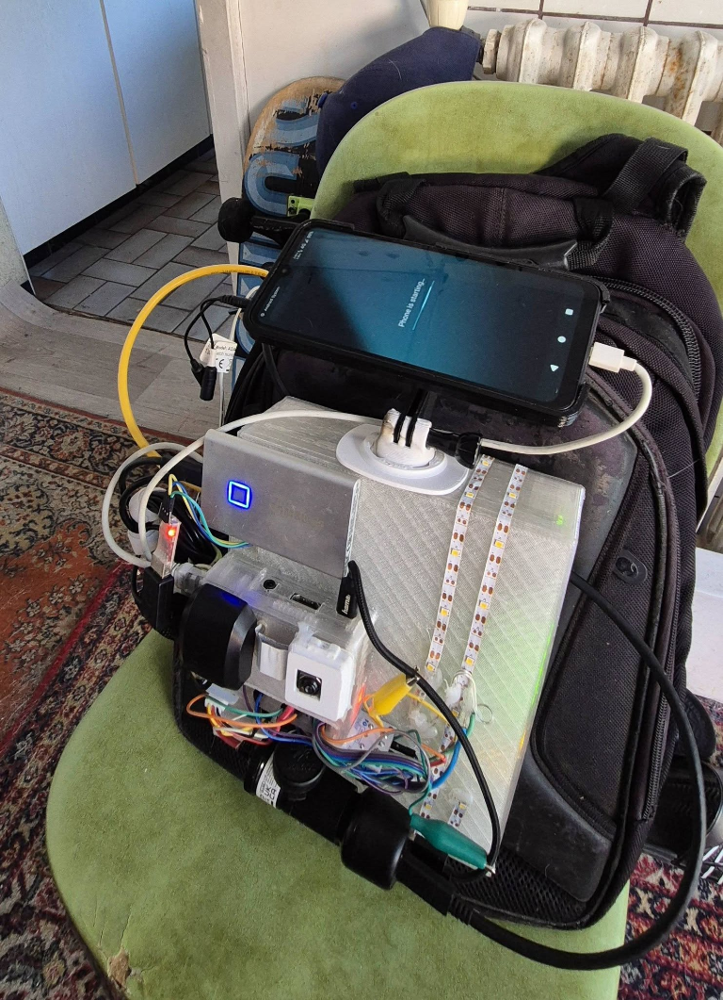
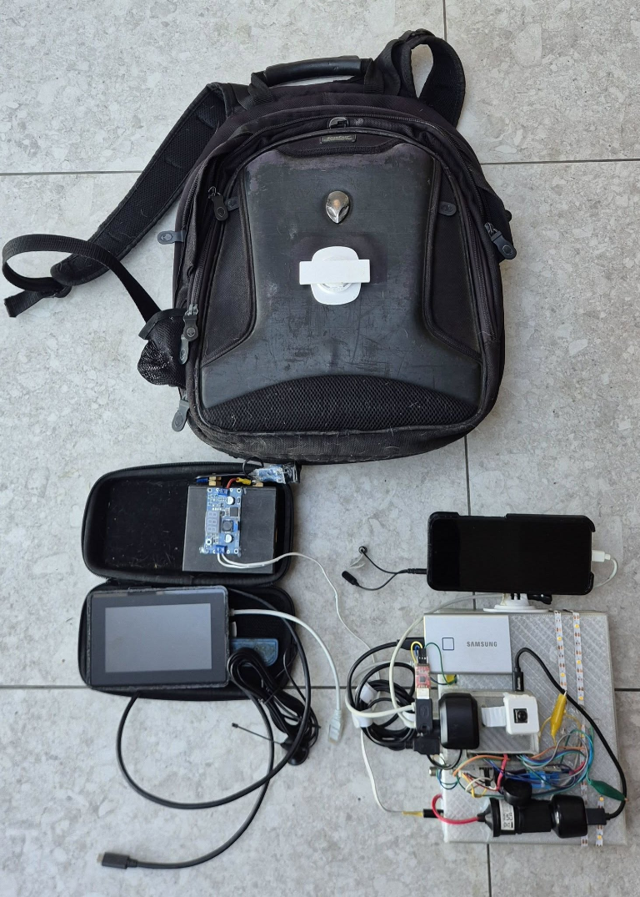

a website for pi2 running bullseye 2023-05-03-raspios-bullseye-armhf-lite.img that can read sensors from the adafruit ads1115 and vma407  it can read volts via 2 alligator clips 
its also connected via adb to a android phone redmi 9a with lineageos20 and can use the cams , sensors ; modem , and flashlights via the website and has a pi2 serving the website and acting as router in to the CH6643 docsis modem for switching and providing internet and phone service via wifi calling on a samsung s24 or other devices that support wifi calling and has a sms backend to send sms via the website ... all in a compact package ... the 3d printed case is available on printables ==> https://www.printables.com/model/1793967-ch6643-modem


#portability and so on 

The web interface adapts to desktop, tablet and phone screens. On smaller screens the control dashboard scrolls and uses larger touch targets; maps and dashboard panels resize or stack to fit.
The FM, LED and phone flashlight controls each have a compact OFF/ON switch.
Its highlight shows the last successful command in the current page, not a
live device reading; after a reload neither side is highlighted.

The whole package is run on a diy made battery pack with 8 cells and a small bms that acts as a ups .. and can be carried in a backpack and provide noc on the go and lights and so on for about 4 hours.  it can be put on a wall charger 17v 3a , it then charges until full and then runs off battery again so its not constantly pulling power from the wall , more tests need to be run on the exact hours and power draw 
it runs super cool and has no cooling fans inside the case the whole thing is passively cooled and runs pretty fast it boots up in around 1 min and can start providing internet in case off emergency 

## Backpack assembly

The current setup is mounted on a backpack, with the LineageOS phone and the
electronics on the outside. The second photo shows the backpack and components
before mounting.




## Phone video

On the main dashboard, **😄 RICK** opens the Rick Astley video in the phone's
browser. Paste a YouTube video link and select **Play on phone** to open another
video. Watch, shortened, Shorts, live and embed video links are supported; extra
parameters such as timestamps are not retained. The phone must be connected and
authorized over ADB, unlocked, online, and have a default browser configured.
**Stop video** stops the phone's browser, including other tabs playing media.
While a video is open, the dashboard shows a phone screenshot refreshed every
three seconds, rather than a live video stream. Stop video ends the refresh.
Anyone with access to the dashboard can request a screenshot of the phone screen.
The dashboard locks the phone in landscape and uses the browser's ADB debugging
interface to start full-screen playback and unmute the video. It restores the
previous rotation setting when stopped. Browser or YouTube restrictions may
prevent playback; the dashboard reports full-screen errors. The browser must
expose its WebView debugging interface over ADB, as Jelly does on the current
LineageOS phone.
The CGI uses the same default phone serial as the camera; set `PHONE_ADB_SERIAL`
in the web service environment to select another phone.

Install the browser-control dependency on the Pi as the web service user:

```
python3 -m pip install --user -r requirements.txt
```

For the isolated HTTPS account, create its private user-package directory
first if its home directory is root-owned:

```
sudo install -d -o websitepi -g websitepi -m 700 /var/lib/websitepi/.local
sudo -u websitepi -H python3 -m pip install --user -r requirements.txt
```

SMS and FM radio temporarily use portrait for their touch controls, then restore
the phone's previous rotation setting. The phone controls wait for one another
to avoid changing orientation during an SMS or FM operation.

## Phone audio

Phone audio integration is currently working and many more plugins 

With the HTTPS security service provisioned and this device's client certificate installed,
select **START MIC** on the UDP Mic page to rescan the USB phone link, stop any
old phone stream, clean up the old receiver, start the new receiver, and send
the phone app a start command over ADB. If the link cannot be detected, startup
stops with an error. Allow the
microphone permission on the phone first. If ADB is unavailable, start the app
manually using the host and port shown on the page. Press play on the audio
player if the browser blocks automatic playback. **STOP** stops the receiver
and sends the phone app a stop command. The receiver reports port conflicts
instead of killing unrelated processes. **TEST TONE** checks browser audio
without using the microphone. Browser audio is delivered through HTTPS; the
phone-to-Pi UDP microphone link is still unencrypted.

The dashboard's **Signals** page uses the phone flashlight to transmit a typed
Morse message or a strobe at up to two flashes per second. Morse finishes
automatically; the strobe continues until **STOP**, and both end with the
light off. The service also attempts to turn the light off if it stops
unexpectedly; a disconnected phone can prevent this. Flashing light can trigger
photosensitive seizures. Stop a signal
before using the ordinary flashlight buttons or phone camera. Install and
enable `piscripts/websitepi-phone-light.service` for this feature.

The Bluetooth Mic uses the Pi 5's connected headset and PipeWire. The staged
script reports a missing Bluetooth microphone rather than restarting Bluetooth
or PipeWire; the isolated HTTPS account also needs separately restricted SSH
access to the Pi 5 before this feature can work.

## Air quality map

The AIR page shows EU stations by default; GLOBAL shows stations from WAQI, and HEAT toggles the Google Air Quality overlay. To keep the map responsive, at most 500 stations within the current view are displayed, spread across the view. Touchscreen phones use a 100-station limit and a road map by default to reduce rendering load; the map type can still be changed. When more stations are available, zoom in to see more detail. The status shows the displayed and total valid stations in view.

For the isolated HTTPS service, install the existing Maps browser key as
`/etc/websitepi-sec/google-maps-key`, owned by root and readable by the
`websitepi` group. The browser receives this key, so restrict its allowed
HTTP referrers and APIs in Google Cloud, including the HTTPS website hostname.
The legacy service continues to use `/home/q/.websitepi/google_maps_key`.

## Security and network status

The SEC button opens a connection diagram with selectable devices; port labels
reflect the last manually confirmed layout, not live port detection. Hover,
focus or tap a device to see its OUI and approximate traffic. The HTTPS access
gate requires a trusted MAC and a provisioned client certificate; its protected
MAC and certificate inventories must be provisioned outside the web root.
The HTTPS service and certificate trust require separate setup; merely copying
the files does not enable them. MAC addresses can change or be spoofed, and
the trusted list is not a firewall. Other services and hardware-switched
connections need their own access controls. The previous network diagnostics and reports remain available in
expandable sections.

The proposed HTTPS service runs as a dedicated `websitepi` account, not `q`.
Provision that account and the required device, log, certificate and policy
permissions before enabling the service. The account needs `dialout`, `i2c`,
`gpio` and `video` access for the corresponding hardware functions; those groups grant
direct access to the devices. Pi commands in WebShell run locally as the
website account and do not have `q`'s administrative privileges. Modem and
phone commands retain their existing remote access; limiting the Pi account
does not restrict those devices. The live HTTP service must be disabled or
independently secured before this isolation protects anything: the dedicated
account can otherwise reach its privileged CGI endpoints. Bluetooth access
needs separate provisioning.

The HTTPS socket listens on port 443, so the configured HTTPS name needs no
port number. The optional port 80 listener serves only a redirect to the
fixed name in the root-managed `WEBSITEPI_HTTPS_HOST` setting; it does not
serve site content or redirect request bodies. The first HTTP request is not
encrypted and can be intercepted; use the HTTPS URL directly when possible.
On the current Pi, use `https://stuntlc.duckdns.org/` with an enrolled client
certificate; the old port 8080 service is disabled. The client-CA signing key
is kept separately on the PC, not on the Pi. Keep an encrypted, secure backup
of it and the client credentials: losing the signing key prevents issuing
additional client certificates from that CA.

The HTTPS unit uses `/var/lib/websitepi/logs` for its mutable website data.
Create it with access limited to the website account and migrate the needed
inventory, labels and OUI data before switching services. Do not grant the
website account write access to the existing `q` log directory: `q` services
also write there. The legacy HTTP service keeps using the old directory.
Create `/var/lib/websitepi/media` with access limited to `websitepi` for
camera photos and their latest-photo marker. HTTPS serves only JPEG photos
and that marker from this directory after the same access checks; the legacy
HTTP service continues to use `piscripts`.

The public Let's Encrypt server certificate needs manual DNS renewal. After
renewing it for the hostname in `/etc/websitepi-sec/redirect.env`, run
`sudo /usr/local/sbin/websitepi-refresh-tls` to validate and install the new
certificate and key and restart the HTTPS service if it is running. Install
`piscripts/websitepi-refresh-tls.sh` at that path as a root-owned executable.
The separate client-CA signing key is not needed for server-certificate
renewal and must not be readable by the website account.
The current certificate uses manual DNS verification, with no email reminders.
Check its expiry with:

```
sudo openssl x509 -in /etc/websitepi-sec/tls/server.crt -noout -enddate
```

Renew it with `sudo certbot certonly --manual --preferred-challenges dns
--cert-name stuntlc.duckdns.org -d stuntlc.duckdns.org`, complete the DNS
challenge, then run the refresh command above. Preserve the DuckDNS A record
when updating its TXT record.

The current Pi has a root-only pre-cutover backup at
`/var/backups/websitepi-before-https-20261121`. Restoring legacy HTTP would
reintroduce its privileged unauthenticated endpoints; do not start it as a
normal fallback. Keep the CA signing key off the Pi if legacy HTTP is restored.
Pi 2 FTP remains enabled for the modem's `/home/q/busybox.root`; its local
account logins are not encrypted. Pi 2 Telnet and Samba are disabled, while
the modem's separate storage services are unchanged.

The shared phone UI and UDP Mic locks use `/run/websitepi`. Install
`piscripts/websitepi-runtime.conf` in `/etc/tmpfiles.d/` and run
`systemd-tmpfiles --create` before deploying all users of those locks together.
The directory is root-owned; the lock files are shared between `q` and
`websitepi`. Switching only one phone-control script would break coordination.

The optional `piscripts/websitepi-reboot.pkla` grants only the website account
the normal system reboot actions on polkit 0.105. Install it under
`/etc/polkit-1/localauthority/50-local.d/` as root before enabling the reboot
control. It does not grant sudo or access to root files. This permission allows
a compromised website account to reboot the Pi.

The optional `websitepi-sms-monitor.socket` and
`websitepi-sms-monitor@.service` allow the website account to start only
`smschecker.service`. Install both units as root, then enable the socket.
The website reports an error if the monitor cannot be started.

SEC reads the optional IEEE MA-L CSV registry from the website log directory
before the system OUI files; keep it current to recognize newer prefixes. A vendor lookup
identifies the registered prefix, not the device model, and randomized MAC
addresses cannot reliably identify a vendor. The registry is not downloaded
automatically. For the legacy service, update it on the Pi with:

```
curl -fL -o logs/ieee-oui.csv.new https://standards-oui.ieee.org/oui/oui.csv &&
  mv logs/ieee-oui.csv.new logs/ieee-oui.csv
```

**CHECK SIM DATA** sends Orange Belgium's
prepaid USSD balance request on demand and displays the data line returned by
the carrier. It temporarily opens the phone dialer, may interrupt the current
app, and reports an error if its dialog cannot be closed. The phone must be
available over ADB and its screen must be readable. The carrier response is
not refreshed automatically; verify its wording before treating it as the
remaining allowance. Phone `ccmni0` and `rndis0` RX/TX counters
show MiB since each interface was last reset. They overlap and are not carrier
billing totals. The optional `security-usage.service` counts IPv4 client traffic
forwarded through Pi `eth0` and phone `usb0`. Its per-device figures are
approximate: they start after discovery and may miss or misattribute traffic
during discovery, address changes, or downtime. They exclude Pi and phone
traffic and are not carrier billing totals. Quotas and client blocking are not
implemented; switched LAN traffic may bypass the Pi and modem CPU.
SEC also reads the Realtek switch's per-station Wi-Fi counters when its serial
console is free. These include local traffic, reset on reconnect, and cannot be
used as per-device SIM billing totals. A busy or unavailable serial console is
reported on the page rather than interrupted.

On the tested Realtek radio, a temporary driver ACL disconnected a Wi-Fi client
without a switch reboot. This was a manual test, not SEC enforcement: the
client needed to reconnect and the rule was not persistent. A separate manual
test temporarily disabled the Pi 5's Ethernet port and restored it; this
isolates the whole port, not individual devices behind a shared connection.
Neither mechanism is integrated into SEC.

To install the accounting service on the Pi:

```
sudo install -d -o root -g root -m 755 /var/lib/websitepi-sec
sudo install -o root -g root -m 755 piscripts/security_usage.py /usr/local/sbin/websitepi-security-usage.py
sudo install -o root -g root -m 644 piscripts/security-usage.service /etc/systemd/system/security-usage.service
sudo systemctl daemon-reload
sudo systemctl enable --now security-usage.service
```

The service adds only non-blocking iptables accounting rules. The rules remain
after stopping the service so their counters can be recovered when it restarts;
they are cleared by a reboot. The page reports stale data when the service stops.

#storage

There is also a 500gb ssd atached to the usb port on the modem that stores files and shares them to all connected devices over smb and ftp 
